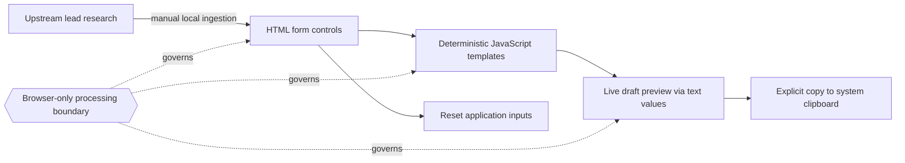

# AI Lead Finder Email Generator

A privacy-first browser application that converts structured lead research into personalized sales-email drafts.

The tool was designed as a companion to an AI-assisted lead research workflow. Research and prospect intelligence can be gathered upstream, while this application turns structured inputs into consistent outreach using deterministic browser-side logic.

No lead data is sent to an external service. The application requires no account, API key, backend, database, or internet connection.

## Business Problem Solved

Lead research is useful only if it can be translated efficiently into relevant outreach. This tool creates a structured handoff between prospect research and sales execution while keeping sensitive lead information local to the browser.

### Persona pain points

- **Account executives and business-development representatives:** Research is often scattered across notes and must be reformatted before it can support outreach.
- **Sales managers:** Draft quality can vary when each representative translates the same positioning into a message differently.
- **Privacy-conscious teams:** Prospect context should not be sent to another service merely to assemble a draft.

### Business value and ROI boundary

The application removes repetitive formatting between research and a usable first draft, makes the drafting logic inspectable, and avoids per-request API costs. The repository does not claim a measured conversion-rate or time-savings result; those outcomes require evaluation in the team's actual sales workflow.

### System invariants

- The application does not transmit or persist lead data; copying the generated draft is an explicit user action.
- Draft generation is deterministic and does not call an external AI service.
- User-entered content is displayed as text rather than injected as executable HTML.
- The tool does not claim to discover, validate, or enrich leads.

Users can combine:

- Business and contact information
- Research notes
- Offer positioning
- Benefits and proof points
- Message type
- Tone
- Subject line
- Opening hook
- Call to action

The resulting draft updates immediately as inputs change.

## Architecture



There is no server-side pipeline or external AI call. The app formats the inputs the user provides; it does not independently find or validate leads. The browser and operating system control clipboard retention and autofill outside the application's state.

## Product decisions

### Privacy by default

The application does not transmit or persist entered lead data.

### Deterministic generation

Email drafts are produced using transparent browser-side message logic rather than an external generative-AI service.

This keeps output fast, predictable, inspectable, and private while allowing AI-assisted research from an upstream workflow to be converted into usable outreach.

### Immediate feedback

The generated message remains visible while the user changes research, positioning, tone, and call-to-action inputs.

### Responsive workflow

The desktop workspace uses a two-column research-and-output interface and collapses into a single-column mobile experience.

## Technology

- Semantic HTML
- Responsive CSS
- Vanilla JavaScript
- Browser Clipboard API
- Client-side state only
- No framework dependencies
- No backend
- No API keys
- No external analytics or tracking

## Repository files

- `index.html` - application structure and input controls
- `styles.css` - responsive layout and visual design
- `app.js` - personalization logic, live generation, copy, and reset behavior
- `portfolio-assets/` - screenshots, validation details, and project case study

## Run locally

Clone the repository or download the files, then open:

```text
index.html
```

in a modern browser.

No installation, build process, server, account, or internet connection is required.

### Optional Docker preview

If you prefer an HTTP preview, run from the cloned repository root:

```bash
docker build -t lead-email-preview .
docker run --rm -p 127.0.0.1:8080:8080 lead-email-preview
```

Open `http://localhost:8080`. The image contains only the three application assets, not local environment files or research notes. The container serves static files; draft generation still runs in the browser. An internet connection is needed for the initial image download.

## Privacy and security

- No application-initiated transmission of entered lead data
- No application-managed persistent storage
- No cookies
- No analytics
- No advertising
- No third-party scripts
- No credentials or secrets required
- User-entered content is not rendered as executable HTML

The application does not transmit or persist entered lead data. Copy email writes the generated draft to your system clipboard. Browser autofill/session restoration and clipboard retention are controlled by your browser and operating system.

## Project documentation

A more detailed product and implementation case study is available in:

[`portfolio-assets/CASE_STUDY.md`](portfolio-assets/CASE_STUDY.md)

## License

Licensed under the [MIT License](LICENSE).
